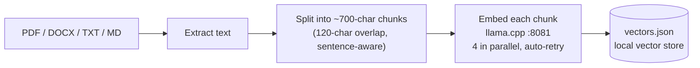
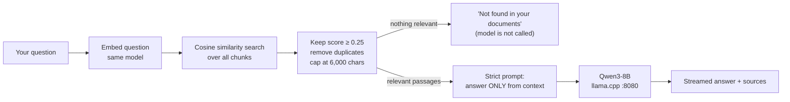

# Chatty — Private, Offline AI Chat with Your Documents

**Chatty is a complete AI assistant that runs 100% on your own computer.** You chat with a large language model, upload your PDFs and Word files, and ask questions that are answered **only from those documents, with the source passages shown**. Nothing is sent to the cloud, no API key is needed, and it keeps working without internet.

It is built on **llama.cpp**, the open-source engine that runs AI models on ordinary laptops, and adds everything llama.cpp and Ollama do not give you out of the box: a document library, retrieval-augmented answers with citations, voice input, a full chat interface with saved conversations, and health checks that tell you exactly what is wrong when something is not running.

> **In one line:** llama.cpp and Ollama *run* a model. Chatty turns that model into a private assistant that can read, search and cite your own documents.

---

## Table of contents

- [Why Chatty exists](#why-chatty-exists)
- [Chatty vs. plain llama.cpp vs. Ollama](#chatty-vs-plain-llamacpp-vs-ollama)
- [Advantages](#advantages)
- [Who it is for](#who-it-is-for)
- [Features](#features)
- [How it works](#how-it-works)
- [Design decisions](#design-decisions)
- [Project structure](#project-structure)
- [Getting started](#getting-started)
- [Using Document (RAG) mode](#using-document-rag-mode)
- [Configuration](#configuration)
- [Troubleshooting](#troubleshooting)
- [Current limitations and roadmap](#current-limitations-and-roadmap)
- [Tech stack](#tech-stack)

---

## Why Chatty exists

Cloud chatbots are convenient, but every document you paste into them leaves your machine. That is a problem for anything private: legal files, medical reports, company documents, research drafts, exam notes.

Running a model locally with llama.cpp or Ollama solves the privacy problem, but on its own you only get a raw chat with the model. It **cannot look inside your files**. If you ask about a 200-page PDF, the model either guesses or you have to paste text in by hand, which quickly runs past the model's context limit.

Chatty closes that gap. It reads your documents once, breaks them into small searchable pieces, and for every question pulls out only the passages that matter. The model then answers from those passages and shows you where each answer came from. Everything happens on your own computer.

---

## Chatty vs. plain llama.cpp vs. Ollama

Chatty does not replace llama.cpp. It **runs on top of it**: llama.cpp is the engine, Chatty is the application around it.

| Capability | llama.cpp (`llama-server`) | Ollama | **Chatty** |
|---|---|---|---|
| Runs AI models locally and offline | ✅ | ✅ | ✅ (via llama.cpp) |
| Chat interface | Basic built-in web UI | CLI, plus a desktop app | ✅ Full React app: sidebar, search, rename and delete chats, themes, font and width settings |
| Upload PDF / DOCX / TXT / MD files | ❌ | Limited (a file can be added to one prompt) | ✅ Persistent document library |
| Searchable index of your documents | ❌ | ❌ | ✅ Local vector store, kept between restarts |
| Answers grounded **only** in your documents | ❌ | ❌ | ✅ Strict "answer only from context" mode |
| Shows the source passage for every answer | ❌ | ❌ | ✅ File name, chunk number and match score |
| Says "not found" instead of guessing | ❌ | ❌ | ✅ Skips generation when nothing relevant is found |
| Handles documents bigger than the model's context window | ❌ | ❌ | ✅ Only the most relevant passages are sent |
| Voice input (speech-to-text) | ❌ | ❌ | ✅ Offline, via whisper.cpp |
| One health check covering chat, embeddings and document index | Server health only | Server health only | ✅ `/health` + live RAG-readiness badge in the UI |

**What llama.cpp and Ollama do better:** they are mature, general-purpose model runners with wide hardware support and huge communities. Chatty depends on llama.cpp for exactly that. Chatty is a *layer above*, focused on one job: private question-answering over your own files.

### Why llama.cpp directly, instead of Ollama?

An earlier version of this project used Ollama. It was moved to **llama.cpp directly** (the backend client file is still called `ollama.js` from that version) because:

- **Full control over every setting.** Context size, port and especially the embedding **pooling mode** (`--pooling mean`) are set explicitly. Wrong pooling silently breaks document search, so the project needs this control.
- **Any GGUF model from Hugging Face** works as-is, with no conversion or registry step.
- **Two dedicated servers**, one for chat and one for embeddings, so indexing a document never blocks a chat answer and each model gets settings tuned for its job.
- **No background service.** Nothing runs on your machine except the servers you start.

---

## Advantages

1. **Complete privacy.** Your documents, questions and answers never leave your computer. This makes Chatty usable for confidential material, where cloud AI is not allowed.
2. **Works offline.** After the one-time model download, no internet is needed: on a train, in a lab, or on a restricted network.
3. **Zero running cost.** No API keys, subscriptions or per-token charges, however much you use it.
4. **Answers you can check.** Every document answer lists the exact source passages and how closely each matched, so you can verify instead of trusting blindly.
5. **Fewer made-up answers.** In Document mode the model is told to answer only from your files. If retrieval finds nothing relevant, Chatty does not even ask the model; it replies that the information is not in your documents.
6. **Works with large documents.** Only the most relevant passages (about 6,000 characters) are sent to the model, so a 300-page PDF works just as well as a 3-page one.
7. **Zero-setup storage.** The document index is a single JSON file. There is no database to install, and you can back it up or delete it like any other file.
8. **Easy to diagnose.** On startup the backend prints the status of every part (embedding server, vector size, number of indexed chunks) and warns when the embedding model changed. The UI shows a live readiness badge.
9. **Open and swappable.** Any GGUF chat model and embedding model can be used, and every tuning value (chunk size, top-K, minimum score) is set in `.env`.

---

## Who it is for

- **Students and researchers:** ask questions across lecture notes, papers and textbooks.
- **Professionals with confidential files:** legal, medical, finance and HR teams who cannot upload documents to cloud AI.
- **Developers:** a clear, readable reference for building a local RAG system on llama.cpp with Node.js and React.
- **Anyone on limited or no internet** who still wants a capable AI assistant.

---

## Features

| Feature | Implementation |
|---|---|
| **Two chat modes** | **Normal** (talk to the model directly) and **Document / RAG** (answers only from your files) |
| **Streaming answers** | Server-Sent Events, rendered token by token |
| **Stop generation** | Cancels the running answer mid-stream |
| **Document upload** | PDF, DOCX, TXT and MD, up to 50 MB each (`pdf-parse`, `mammoth`) |
| **Document library** | List, view and delete indexed documents; synced with the server on startup |
| **Source citations** | File name, chunk number and similarity score appended to each Document-mode answer |
| **Voice input** | Browser recording → ffmpeg → whisper.cpp, fully offline |
| **Model selection** | Lists models live from llama.cpp's `/v1/models` |
| **Chat history** | Multiple chats saved in the browser; search, rename and delete |
| **Rich messages** | Markdown, tables, syntax-highlighted code blocks with copy buttons |
| **Personalisation** | Dark / light theme, font size, chat width |
| **Health monitoring** | `/health` polled every 30 s; RAG-readiness badge in the UI |

---

## How it works

### Architecture

```
┌──────────────────── FRONTEND (React + Vite, :5173) ────────────────────┐
│  ChatWindow · Message · CodeBlock   InputBox · VoiceButton · ModelSelector │
│  DocumentPanel · DocumentViewer · StopButton                            │
│                     │                                                   │
│            Zustand stores (chatStore, documentStore)                    │
│                     │                                                   │
│              services/api.js  (SSE client)                              │
└─────────────────────┬──────────────────────────────────────────────────┘
                      │ HTTP / SSE
┌─────────────────────▼──────────── BACKEND (Express, :5000) ─────────────┐
│  routes: /chat  /upload  /documents  /api/transcribe  /health           │
│                                                                          │
│  ragService → retrievalService → vectorStore (data/vectors.json)         │
│  embeddingService → llama.cpp embeddings (:8081)                         │
│  ollama.js / ollamaService → llama.cpp chat (:8080)                      │
│  chunkingService · whisperService (speech-to-text)                       │
└───────────────┬──────────────────────────────────┬──────────────────────┘
                ▼                                  ▼
     llama.cpp chat server :8080        llama.cpp embedding server :8081
        (Qwen3-8B GGUF)                    (mxbai-embed-large-v1 GGUF)
```

The browser never talks to llama.cpp directly. Everything goes through the backend, which handles streaming, document retrieval and error reporting.

### What happens when you upload a document



Chunks overlap so that a sentence cut at a boundary still appears whole in one of them. Embeddings run four at a time with automatic retries, so a single slow request does not fail the whole upload.

### What happens when you ask a question



1. **Retrieve:** the question is embedded with the same model used for the documents and compared against every stored chunk. The search fetches three times the needed results, then drops weak matches (score below 0.25) and near-duplicates, such as the same file uploaded twice.
2. **Check:** if nothing passes, Chatty answers "not found" immediately, without spending time on the model.
3. **Generate:** otherwise the best passages, each labelled with its source, are placed in a strict prompt that forbids outside knowledge. The answer streams back with its sources.

---

## Design decisions

| Area | Decision | Why |
|---|---|---|
| Vector store | One JSON file, not a database | Zero setup, portable, works offline |
| Embeddings | llama.cpp `--embedding --pooling mean` | Runs locally; no OpenAI key |
| Two llama.cpp servers | Separate chat and embedding processes | Indexing never blocks chatting; each model gets its own settings |
| Streaming protocol | Custom SSE events: `token`, `done`, `error`, `sources` | Simple over plain HTTP; no WebSockets needed |
| Thinking tags | Qwen3's `<think>…</think>` stripped while streaming, even when a tag is split across tokens | Users see the answer, not the model's internal reasoning |
| Empty retrieval | Return "not found" without calling the model | Saves time and prevents invented answers |
| Dimension check | Fail fast if the embedding size changes | Prevents silent `NaN` scores after switching models |
| Embeddings never sent to the browser | Only file, chunk, score and a preview go to the UI | Keeps responses small and fast |
| Persistence | localStorage writes debounced to 500 ms | Keeps typing smooth |

---

## Project structure

```
chatty_AI_Local_chatbot/
├── package.json            # root scripts: install:all, llama, dev
├── scripts/
│   └── start-llama.sh      # starts both llama.cpp servers
├── backend/
│   ├── server.js           # Express entry point + startup diagnostics
│   ├── .env.example        # copy to .env
│   ├── routes/             # chat, upload, documents, transcribe
│   └── services/
│       ├── ragService.js        # prompt building + grounded generation
│       ├── retrievalService.js  # search, filtering, dedup, context assembly
│       ├── vectorStore.js       # JSON store + cosine similarity
│       ├── embeddingService.js  # parallel embedding with retries
│       ├── chunkingService.js   # sentence-aware chunking with overlap
│       ├── ollama.js            # llama.cpp client (name kept from the Ollama version)
│       └── whisperService.js    # speech-to-text via whisper.cpp
└── frontend/
    ├── index.html
    ├── vite.config.js
    └── src/
        ├── components/     # ChatWindow, InputBox, DocumentPanel, VoiceButton, ...
        ├── store/          # chatStore.js, documentStore.js (Zustand)
        └── services/       # api.js (SSE), upload.js, transcribe.js, ...
```

---

## Getting started

### Prerequisites

- **Node.js 18+** and npm
- **llama.cpp**, built so that `llama-server` is on your PATH ([build guide](https://github.com/ggml-org/llama.cpp/blob/master/docs/build.md))
- *Optional, for voice input:* **ffmpeg** and **whisper.cpp** (see [Voice input](#voice-input-optional))

### 1. Download the models

Model files are not stored in this repository. Download them into a `models/` folder at the project root:

| Role | Hugging Face repo | File |
|---|---|---|
| Chat | [Qwen/Qwen3-8B-GGUF](https://huggingface.co/Qwen/Qwen3-8B-GGUF) | `Qwen3-8B-Q4_K_M.gguf` (~5 GB) |
| Embeddings | [ChristianAzinn/mxbai-embed-large-v1-gguf](https://huggingface.co/ChristianAzinn/mxbai-embed-large-v1-gguf) | `mxbai-embed-large-v1.Q4_0.gguf` |

If you keep them somewhere else, set `CHAT_MODEL_PATH` and `EMBED_MODEL_PATH` in `backend/.env`. Any GGUF chat model works; a smaller one (for example a 4B model) runs faster on modest hardware.

### 2. Install dependencies

```bash
git clone https://github.com/vigneshpandianalagukumar/chatty-ai-local-chatbot.git
cd chatty-ai-local-chatbot
npm run install:all
cp backend/.env.example backend/.env
```

### 3. Run it

The app runs as four processes. Use two terminals:

```bash
# Terminal 1: both llama.cpp servers (chat :8080 + embeddings :8081)
npm run llama

# Terminal 2: backend (:5000) + frontend (:5173)
npm run dev
```

Then open **http://localhost:5173**.

| Process | Purpose | Port |
|---|---|---|
| llama.cpp chat server | LLM inference | 8080 |
| llama.cpp embedding server | Vectors for document search | 8081 |
| Backend (`npm start`) | Express API, RAG, uploads | 5000 |
| Frontend (`npm run dev`) | React + Vite dev server | 5173 |

<details>
<summary>Prefer separate terminals? Run each process by hand</summary>

```bash
llama-server -m models/Qwen3-8B-Q4_K_M.gguf -c 8192 --port 8080
llama-server -m models/mxbai-embed-large-v1.Q4_0.gguf --embedding --pooling mean -c 512 --port 8081
cd backend && npm start
cd frontend && npm run dev
```
</details>

When the backend starts you should see:

```
Server running on port 5000
--- RAG status ---
  Embedding server: OK (1024 dims)
  Vector store: 0 chunks, 0 documents
```

---

## Using Document (RAG) mode

1. Click **+ New Chat**.
2. In the header, switch the mode to **Document (RAG)**; a purple badge appears.
3. Click **Attach** and pick a PDF, DOCX, TXT or MD file.
4. Press **Enter** to upload and index it.
5. Ask questions about the document. Each answer ends with a **Sources** list showing the file, chunk and match score.

## Voice input (optional)

Voice input records audio in the browser and transcribes it on the backend with [whisper.cpp](https://github.com/ggml-org/whisper.cpp), without any internet connection.

1. Install `ffmpeg`.
2. Clone and build whisper.cpp at the project root (`./whisper.cpp`), and download the `ggml-base.en.bin` model into `whisper.cpp/models/`.
3. If whisper.cpp lives elsewhere, set `WHISPER_CLI_PATH` and `WHISPER_MODEL_PATH` in `backend/.env`.

---

## Configuration

All backend settings are optional and documented in [`backend/.env.example`](backend/.env.example):

| Variable | Default | What it controls |
|---|---|---|
| `PORT` | 5000 | Backend port |
| `LLAMA_CHAT_HOST` / `LLAMA_CHAT_PORT` | localhost / 8080 | Chat server |
| `LLAMA_EMBED_HOST` / `LLAMA_EMBED_PORT` | localhost / 8081 | Embedding server |
| `CHUNK_SIZE` / `CHUNK_OVERLAP` | 700 / 120 | How documents are split |
| `RAG_TOP_K` | 5 | Passages used per answer |
| `RAG_MIN_SCORE` | 0.25 | Minimum similarity to count as relevant |
| `RAG_MAX_CONTEXT` | 6000 | Maximum characters of context sent to the model |
| `EMBED_CONCURRENCY` | 4 | Parallel embedding requests during upload |
| `CHAT_MODEL_PATH` / `EMBED_MODEL_PATH` | `./models/...` | Model files used by `npm run llama` |
| `WHISPER_CLI_PATH` / `WHISPER_MODEL_PATH` | `./whisper.cpp/...` | Speech-to-text binary and model |

The frontend calls the backend at `http://localhost:5000` by default; set `VITE_API_URL` in `frontend/.env` to change it.

---

## Troubleshooting

If the RAG badge shows **"Backend offline"** or **"Embedding server down"**:

- Check that both llama.cpp servers are running on ports 8080 and 8081.
- Look at the backend console; it names the server and port it cannot reach.
- Open http://localhost:5000/health to see the JSON status of every component.
- If the backend reports an embedding **dimension mismatch**, you changed the embedding model after indexing. Delete `backend/data/vectors.json` and upload your documents again.

---

## Current limitations and roadmap

Being clear about what Chatty does not do yet:

- **Normal mode is single-turn.** Each message is sent to the model on its own, without earlier messages in the chat. *Planned:* send recent conversation history.
- **Scanned PDFs are not read.** Text is extracted from the PDF itself, so image-only scans need OCR first. *Planned:* built-in OCR.
- **Search is a simple full scan.** Perfect for hundreds of documents; a very large library would benefit from an approximate-nearest-neighbour index. *Planned:* optional faster index.
- **Voice input uses an English-only Whisper model** by default. Multilingual Whisper models can be swapped in. *Planned:* multilingual voice and answers.
- **Keyword + meaning search.** Retrieval currently uses meaning (embeddings) only. *Planned:* hybrid search that also matches exact terms such as section numbers.

---

## Tech stack

**Frontend:** React 19, Vite, Zustand, Tailwind CSS, Framer Motion, react-markdown, react-syntax-highlighter
**Backend:** Node.js, Express 5, Multer, pdf-parse, mammoth, dotenv
**AI:** llama.cpp (Qwen3-8B chat, mxbai-embed-large embeddings), whisper.cpp

## Author

**Vignesh Pandian A** — [@vigneshpandianalagukumar](https://github.com/vigneshpandianalagukumar)
